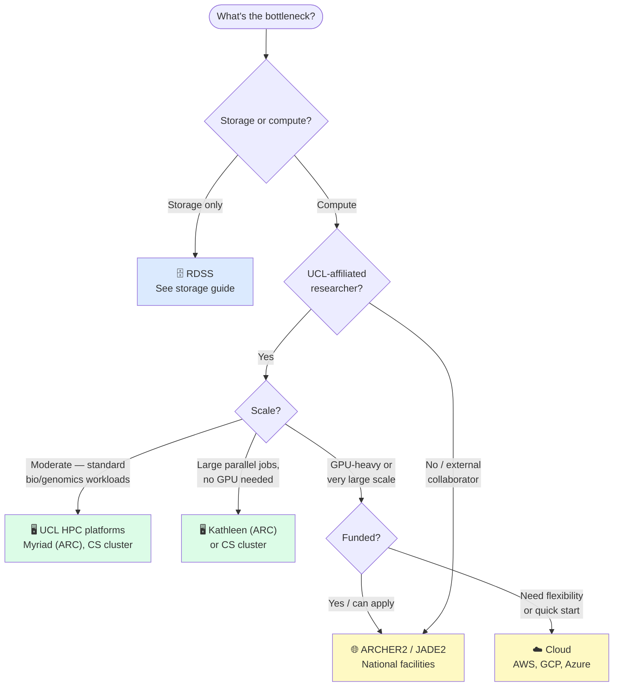

# HPC & Cloud Computing Guide — UCL Biosciences
{: .no_toc }

**Note.** This is a work-in-progress — some details may need updating/amending.

> **Who is this for?** Researchers whose data are too large to store locally, or whose analyses are too slow or memory-hungry to run on a laptop. This guide orients you to the available options and signposts to detailed documentation elsewhere — it does not replace the documentation for individual platforms.

---

## Is HPC what you need?

HPC is not always the answer. Before requesting access, it's worth being clear on the problem:

| Problem | Likely solution |
|---|---|
| Files too large to store on laptop | RDSS (see [storage guide]()) — you may not need HPC at all |
| Analysis too slow on laptop | HPC compute — see the UCL platforms below |
| Analysis needs more RAM than laptop has | HPC compute — check memory requirements before submitting |
| Analysis needs a GPU | Check availability on UCL platforms, or cloud |
| Need to run hundreds of jobs in parallel | HPC — this is where it excels |
| Collaborators outside UCL need same environment | Cloud or national facilities may be more practical |

---

## Which system?



---

## UCL systems at a glance

UCL has two main HPC platforms available to Biosciences researchers: systems managed by [Advanced Research Computing (ARC)](https://www.rc.ucl.ac.uk/) and the [CS HPC cluster](https://hpc.cs.ucl.ac.uk/) managed by the Department of Computer Science. Both are useful options — the right choice depends on your workload and collaborators.

| System | Best for | Scheduler | Free to use | GPU | More info |
|---|---|---|---|---|---|
| **Myriad** | General research computing, most biosciences workloads | SGE | Yes (UCL staff/students) | Yes | [rc.ucl.ac.uk/docs/Clusters/Myriad](https://www.rc.ucl.ac.uk/docs/Clusters/Myriad/) |
| **Kathleen** | High-throughput parallel jobs, large core counts | SGE | Yes (UCL staff/students) | No | [rc.ucl.ac.uk/docs/Clusters/Kathleen](https://www.rc.ucl.ac.uk/docs/Clusters/Kathleen/) |
| **CS HPC cluster** | Most biosciences analyses, offers flexibility in setup and systems | SGE | *CS TBC* | *CS TBC* | [hpc.cs.ucl.ac.uk](https://hpc.cs.ucl.ac.uk/) |
| **Open OnDemand** | When you want a Jupyter or R Studio interface | N/A | Yes | Yes | [OnDemand Info](https://www.rc.ucl.ac.uk/docs/Supplementary/OnDemand/)  |

---

## Getting access

**Myriad and Kathleen** — request an account via the [ARC self-service portal](https://www.rc.ucl.ac.uk/docs/Account_Services/). You will need a UCL userid. Access is usually granted within a few working days. No cost for standard use.

**CS HPC cluster** — see [hpc.cs.ucl.ac.uk](https://hpc.cs.ucl.ac.uk/) for access procedures. Fill in [this form](https://hpc.cs.ucl.ac.uk/account-form/index.html) to request an account, which is generally confirmed within a few working days (*CS TBC*).

**National facilities (ARCHER2, JADE2, etc.)** — access is via UKRI allocation. PIs apply through [SAFE](https://safe.epcc.ed.ac.uk/) or the relevant facility portal. Allocations are granted in compute-hours and typically require a short technical case.

**Cloud (AWS, GCP, Azure)** — UCL has framework agreements that may offer discounted or credited access. Contact your faculty research support team to find out what's available. For small-scale or exploratory use, free tiers are often sufficient.

---

## Submitting jobs

### Login nodes vs compute nodes

When you SSH into an HPC system, you land on a **login node** — a shared machine used by everyone for setting up, editing scripts, moving files, and submitting jobs. It is not for running analyses. Running heavy computation on the login node slows it down for all users and your process may be killed without warning.

**Compute nodes** are where your analysis actually runs. To run jobs on compute nodes, you describe what resources you need (cores, memory, time) in a job script, submit it to the queue, and the scheduler allocates you a compute node when one is available.

### GPUs
GPUs are available on myriad. To submit a job requesting GPUs, see [here](https://www.rc.ucl.ac.uk/docs/Example_Jobscripts/#gpu-job-script-example). On the CS cluster, GPUS are... (*CS TBC*)

### The basic workflow

Myriad, Kathleen and the CS Cluster use **SGE (Sun Grid Engine)**. If you have used SLURM elsewhere, the concepts are the same but the syntax differs.

1. SSH to the login node
2. Stage your data (e.g. copy from RDSS, transfer with `rsync` or `scp`, or transfer via Globus — see the [data sharing guide]())
3. Write a job script specifying resources (cores, memory, wall time)
4. Submit with `qsub`
5. Monitor with `qstat`
6. Retrieve outputs and move off scratch promptly

A minimal SGE job script looks like:

```bash
#!/bin/bash -l
#$ -l h_rt=2:00:00        # wall time
#$ -l mem=8G              # RAM per core
#$ -pe smp 4              # number of cores
#$ -cwd                   # run from current directory
#$ -o logs/job.out
#$ -e logs/job.err

module load <your_software>
your_command --input data/ --output results/
```
## More info for getting started
### ARC HPCs
Full ARC documentation including array jobs, GPU requests, and interactive sessions: [rc.ucl.ac.uk/docs/](https://www.rc.ucl.ac.uk/docs/)

> **If you are new to HPC**, ARC run regular introductory training — see the [ARC training pages](https://www.ucl.ac.uk/advanced-research-computing/education/training) before trying to figure things out from scratch.

### CS HPC
Full getting started info is available through the CS cluster [website](https://hpc.cs.ucl.ac.uk/index.html). You will need an account to receive the site login details before accessing that material. The CS cluster staff also provide regular inductions and training.

---

## Storage on HPC

HPC storage is **not** the same as research data storage — see the [storage guide]() for RDSS, RDR, and related services. The table below refers to Myriad/Kathleen; CS cluster storage is described at [hpc.cs.ucl.ac.uk](https://hpc.cs.ucl.ac.uk/).

| Location | Purpose | Backed up | Purged |
|---|---|---|---|
| `$HOME` | Scripts, config, small files | Yes | No |
| `$SCRATCH` (`/scratch/`) | Job input/output during runs | **No** | No |
| `$TMPDIR` | Temporary files within a single job | **No** | On job end |
| RDSS (mounted) | Long-term research data | Yes | No |

### Myriad ↔ RDSS

RDSS can be accessed directly from Myriad login nodes. See the ISD guide for current setup instructions: [ucl.ac.uk/isd/how-to/rdss-myriad-data-storage-transfer-service](https://www.ucl.ac.uk/isd/how-to/rdss-myriad-data-storage-transfer-service)

### Moving data to/from HPC

- **Small files**: `scp` or `rsync` over SSH to the RDSS or login node
- **Large files**: use Globus (see [data sharing guide]()) — more reliable than rsync for large transfers and can be left unattended
- **From RDSS to scratch before a job**: use `rsync` from the login node to copy from RDSS to scratch. Myriad compute-nodes can't read from RDSS

---

## Software, modules, and containers

The following applies to Myriad and Kathleen. CS cluster software environment details are available at [hpc.cs.ucl.ac.uk](https://hpc.cs.ucl.ac.uk/) (*CS TBC* - do you want to add some links to key info here? Or collect any key info?)

### Environment modules

Rather than installing software yourself, HPC systems provide a large library of pre-installed, optimised packages via the `module` system. This means you don't need to download or build tools yourself, avoids version conflicts, and ensures you're using builds suited to the cluster hardware. Most common bioinformatics tools (STAR, samtools, GATK, R, Python, etc.) are available — check `module avail` before trying to install anything yourself.

```bash
module avail            # list all available software
module load <name>      # load a package into your environment
module list             # see what's currently loaded
module unload <name>    # remove a package
```

If software you need is not available you can request it via the cluster's support staff or install it yourself (e.g. using conda, see below).

### Conda

For Python and R packages not in the module system, conda environments work well on HPC. Load the UCL-provided miniconda module rather than installing conda yourself:

```bash
module load python/miniconda3/4.10.3
source $UCL_CONDA_PATH/etc/profile.d/conda.sh

conda create -n myenv python=3.11
conda activate myenv
conda install <packages>
```

Build and test your environment on the login node, then activate it in your job script using the same two `module load` / `source` lines before calling your commands.

### Containers (Apptainer / Singularity)

Myriad supports **Apptainer** (formerly Singularity) for containerised workflows. This is useful when you need a specific software stack, are running a pipeline with a published container image (e.g. from Docker Hub), or want fully reproducible environments. Docker itself is not supported on HPC for security reasons — Apptainer converts Docker images automatically:

```bash
apptainer pull docker://myimage:tag
apptainer exec myimage.sif mycommand
```

---
## GPUs
UCL is increasing GPU capacity to try to keep up with rapidly increasing demand. Biosciences researchers using UCL infrastructure will likely use GPUs from one of these platforms:
- **Computer Science HPC**. *CS TO ADD*
- **[Unified AI](https://www.ucl.ac.uk/research-innovation/advanced-research-computing/platforms-and-services/unified-ai-platform-research)**. Scalable, GPU-accelerated infrastructure enabling UCL researchers to develop, train, evaluate, and deploy AI and machine learning models. Free tier for lightweight use, paid tier for priority access and extended capability. 
- **[Condenser](https://condenser.arc.ucl.ac.uk/)**. Condenser is a private cloud platform for UCL based on traditional High-Performance Computing (HPC) hardware. GPUs are available following same costing model as UAI.
- **Myriad**. Myriad has a number of [GPU nodes](https://www.rc.ucl.ac.uk/docs/Clusters/Myriad/#gpus) available for free. These are open to all UCL researchers and demand can be high.

## When HPC isn't the answer

HPC has a learning curve and is not always the most efficient route. Consider alternatives when:

- **Your analysis is interactive** — HPC batch queues mean waiting; for exploratory work a cloud VM or UCL's virtual desktop may be faster to iterate on
- **You need specialist infrastructure** — clinical data requires the DSH/TRE; some deep learning workloads are better served by JADE2 or cloud GPU instances
- **Your collaborators need access** — national facilities or cloud might be easier to share with external partners than UCL HPC

---

## Further help

| Need | Contact / resource |
|---|---|
| Myriad / Kathleen account, job issues | [rc-support@ucl.ac.uk](mailto:rc-support@ucl.ac.uk) |
| ARC documentation | [rc.ucl.ac.uk/docs](https://www.rc.ucl.ac.uk/docs/) |
| ARC training | [ucl.ac.uk/advanced-research-computing/education/training](https://www.ucl.ac.uk/advanced-research-computing/education/training) |
| CS HPC cluster | [hpc.cs.ucl.ac.uk](https://hpc.cs.ucl.ac.uk/) |
| Myriad ↔ RDSS setup | [ucl.ac.uk/isd/how-to/rdss-myriad-data-storage-transfer-service](https://www.ucl.ac.uk/isd/how-to/rdss-myriad-data-storage-transfer-service) |
| RDSS general, data movement | [researchdata-support@ucl.ac.uk](mailto:researchdata-support@ucl.ac.uk) |
| National facility applications | [rc-support@ucl.ac.uk](mailto:rc-support@ucl.ac.uk) |
| Cloud access / UCL agreements | Contact ARC or faculty research support |
